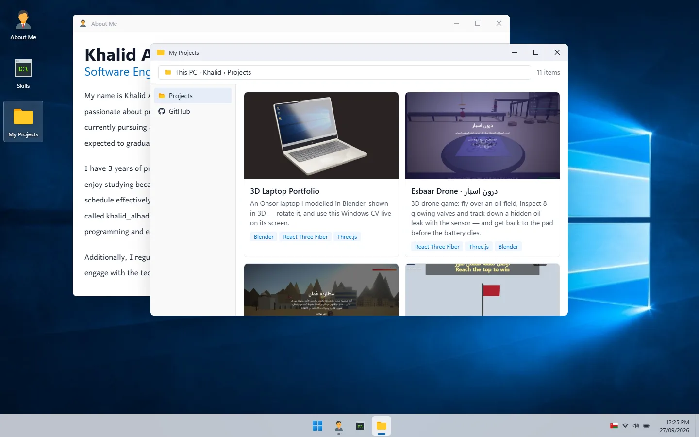

# Windows CV — Khalid Alhadi

My CV built as a **Windows 11 desktop** in the browser. Open "About Me", "Skills" and "My Projects" as real windows: drag them, minimize, maximize, use the Start menu and taskbar, and even shut the PC down.

**Live demo:** https://creative-rolypoly-4bbeb4.netlify.app/



## Features

- **Desktop icons**: click to open, drag to rearrange (positions are saved in the browser)
- **Real windows**: drag, focus, minimize, maximize and close, with several windows open at once
- **Taskbar & Start menu**: with a live clock and an active-window indicator
- **Shut down flow**: confirmation dialog and a shut-down screen
- **My Projects**: a File-Explorer-style gallery of my projects with live links
- **Responsive**: on small screens, windows open at 70% size and cascade

## Tech stack

- React 18 + Vite
- Tailwind CSS v4
- react-icons

## Run locally

```bash
npm install
npm run dev
```

Build for production:

```bash
npm run build
```

## Add a project

Projects live in [`src/data/projects.js`](src/data/projects.js). Add an object and drop its image in `public/projects/`:

```js
{
  name: "My App",
  description: "What it does.",
  image: "projects/my-app.jpg",
  tech: ["React", "Tailwind CSS"],
  link: "https://my-app.netlify.app/",
}
```

## Project structure

```
src/
├── App.jsx              # desktop, window manager, icons
├── components/
│   ├── Window.jsx       # draggable window frame
│   ├── Taskbar.jsx      # taskbar + clock
│   ├── StartMenu.jsx
│   ├── AboutMe.jsx
│   ├── Skills.jsx
│   ├── MyProject.jsx    # File Explorer-style project gallery
│   ├── AskToShutDownOrNot.jsx
│   └── ShutDown.jsx
└── data/projects.js     # the project list
```
